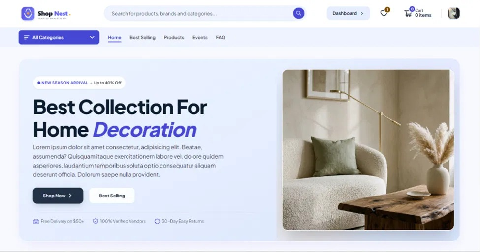
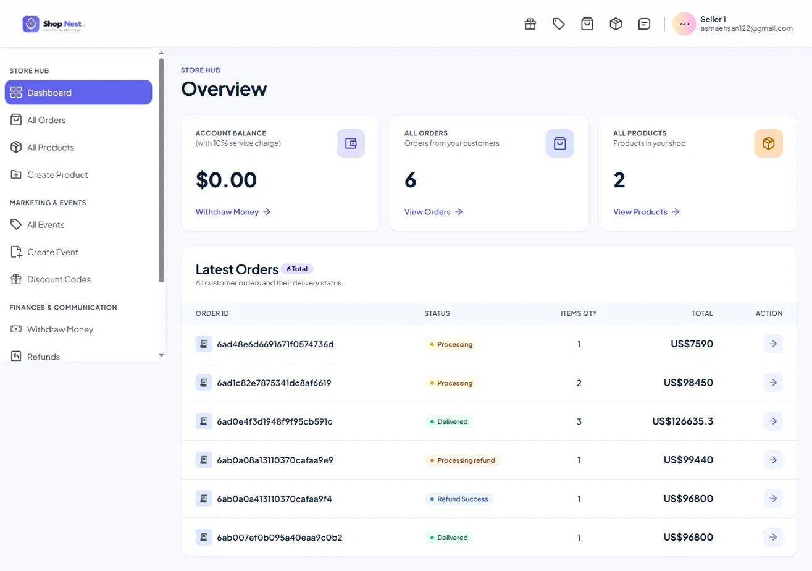
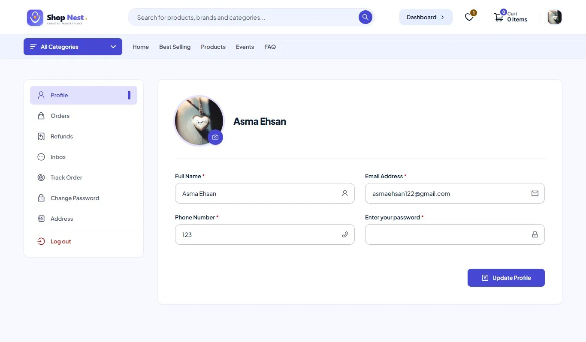
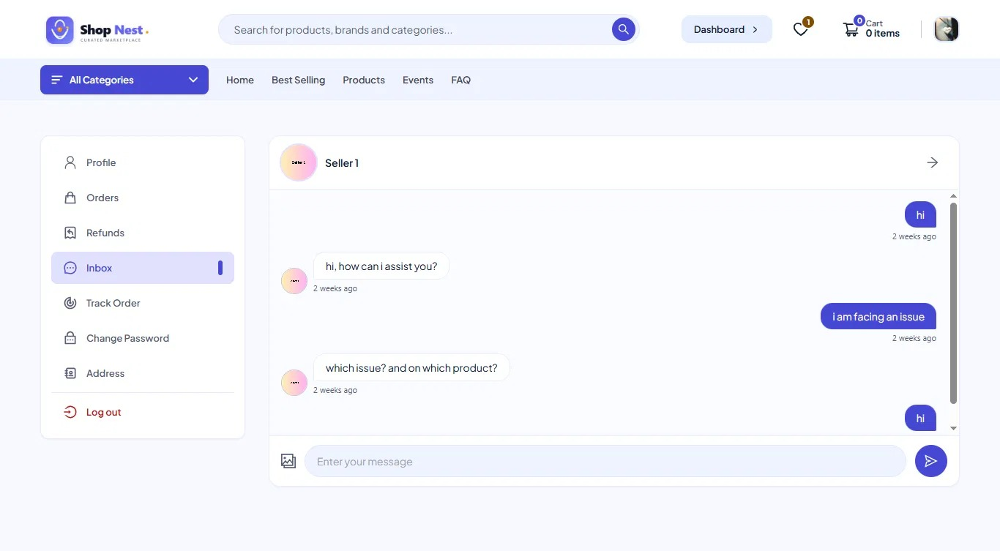
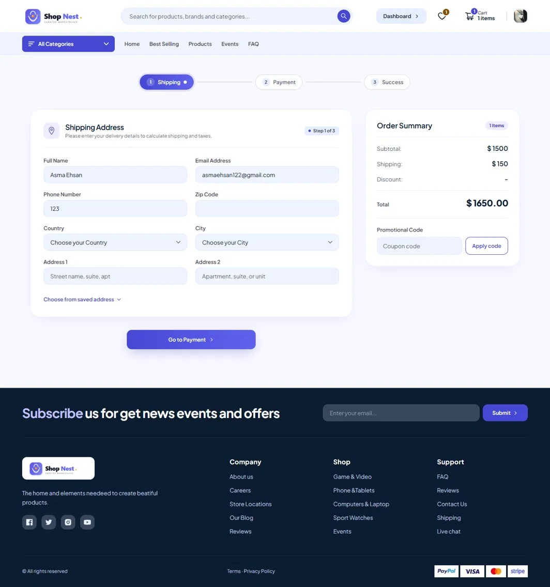

# 🛍️ ShopNest – Multi-Vendor E-Commerce Marketplace

A full-stack multi-vendor marketplace built with the MERN stack, where small sellers open their own online shops and buyers shop from many sellers in one place, with online payment, order tracking, and live chat.


---

## 📌 Project Banner

```
+-----------------------------------------------------------------------------------+
|                                                                                   |
|                              🛍️  SHOPNEST MARKETPLACE                             |
|              Curated Multi-Vendor E-Commerce for Buyers and Sellers               |
|                                                                                   |
+-----------------------------------------------------------------------------------+
```



---

## 📖 Overview

ShopNest is a multi-vendor e-commerce website. Many independent shops sell their products in one place, and customers can buy from any of them in a single checkout. Think of it as one website with many sellers.

### 🎯 The Problem It Solves

- **Small sellers** often cannot afford to build a full website and need technical skill to do it. Without one, few people find them.
- **Buyers** have to visit many websites or social pages to compare products, and it is hard to judge whether a seller is trustworthy or to ask a question before buying.
- **A single cart with items from several vendors** needs separate order tracking and delivery status for each shop.

### 💡 How ShopNest Helps

- Sellers get a ready-made shop and dashboard to manage products, events, coupons, and orders.
- Buyers find products from many shops in one place, pay online, track orders, and read reviews and ratings.
- Live chat lets a buyer ask a seller questions directly, which builds trust before buying.

### 👥 Who It's Built For

| Role | What they can do |
|------|------------------|
| **Buyers** (`user`) | Sign up, browse products and events, use cart and wishlist, check out, track orders, request refunds, review products, chat with sellers |
| **Vendors** (`Seller`) | Create a shop, manage products, create events and coupon codes, fulfil orders, handle refund requests, chat with buyers |

> ShopNest currently has two roles: buyers and sellers. An admin panel is planned as a future improvement.

### 🏗️ High-Level Architecture

- **Frontend:** React single-page app (Create React App) with Redux Toolkit, React Router, Material UI, and Tailwind CSS.
- **Backend:** Node.js and Express 5 REST API with MongoDB (Mongoose) at `/api/v2`.
- **Real-time service:** A separate Socket.IO server in `socket/` for live chat and online presence.
- **Media storage:** Cloudinary for product images, event images, shop logos, user avatars, and chat images.

---

## 📸 Screenshots

| Seller Dashboard | Buyer Profile |
|:---:|:---:|
|  |  |

| Buyer–Seller Chat | Checkout |
|:---:|:---:|
|  |  |

---

## ✨ Features

### 🔒 Authentication & Authorization
- **Separate buyer and seller flows:** Each has its own registration, login, logout, and protected routes.
- **JWT in HTTP-only cookies:** Tokens are generated for both users and sellers and stored in cookies (`token` and `seller_token`).
- **Email verification:** Accounts are activated through Nodemailer links containing a signed, expiring JWT.
- **Password hashing:** Passwords are hashed with bcrypt and excluded from queries by default (`select: false`).
- **Route protection:** `isAuthenticated` and `isSeller` middleware guard private endpoints, and the frontend has protected customer and seller routes.
- **Password update:** Authenticated buyers can change their password.

### 🛍️ Customer Features
- **Product discovery:** Browse the full catalog, filter by category, and view best-selling products.
- **Product details:** Description, pricing, multiple images, stock, shop details, reviews, and ratings.
- **Shop preview:** View a seller's public storefront and their products.
- **Flash sale events:** Browse time-limited promotional events with special pricing.
- **Reviews and ratings:** Submit a text review and star rating; the product's average rating is recalculated.
- **Cart and wishlist:** Managed with Redux Toolkit and persisted in browser local storage.
- **Address book:** Save, edit, and delete multiple delivery addresses, or enter one manually at checkout.
- **Checkout:** Shipping calculation, coupon codes, validation, and an order summary before payment.
- **Orders:** Order history, order details, order tracking, and a success page after payment.
- **Refunds:** Request a refund and follow its status.
- **Profile:** Update personal info and avatar (stored on Cloudinary).

### 🏪 Seller (Vendor) Features
- **Storefront:** Shop name, description, address, phone, ZIP code, and logo.
- **Seller dashboard:** Account balance (with a 10% service charge calculation), total orders, total products, and latest orders.
- **Product management:** Create and delete products with multiple Cloudinary images, tags, pricing, discount pricing, and stock.
- **Event management:** Create and delete flash sale events with start and end dates, pricing, stock, and images.
- **Coupon codes:** Create shop-specific percentage coupons and delete them.
- **Order fulfilment:** View orders for the shop and update delivery status.
- **Refund management:** Review and approve refund requests; stock is restored on approval.
- **Messaging:** Dedicated inbox to chat with buyers in real time.

### 💬 Real-Time Features
- **Separate Socket.IO server** with online-user tracking by user ID and socket ID.
- **Instant message delivery** to online recipients, with live last-message updates.
- **Persistent history:** Messages and conversations are also saved through the REST API, so chats survive page refreshes.

### 💳 Payments & Order Splitting
- **Stripe:** The backend creates PaymentIntents and the frontend confirms them with Stripe Elements.
- **PayPal:** Supported on the frontend through `@paypal/react-paypal-js`.
- **Cash on Delivery:** Available as a payment option.
- **Payment tracking:** Each order stores its payment ID, status, and type.
- **Multi-vendor order splitting:** Cart items are grouped by `shopId`, and one order is created per vendor.

---

## 🛠️ Tech Stack

### Frontend
| Category | Technology |
|----------|------------|
| Core | React 19, React DOM 19, Create React App (`react-scripts` 5) |
| Routing | React Router DOM v7 |
| State management | Redux Toolkit, React Redux |
| Styling | Tailwind CSS 3, Material UI 9, Emotion, PostCSS, Autoprefixer |
| Payments | Stripe (`@stripe/react-stripe-js`, `@stripe/stripe-js`), PayPal (`@paypal/react-paypal-js`) |
| Real-time client | Socket.IO Client |
| HTTP client | Axios |
| UI utilities | React Icons, React Toastify, timeago.js, country-state-city |
| Testing | React Testing Library, Jest DOM |

### Backend
| Category | Technology |
|----------|------------|
| Runtime | Node.js 22 |
| Framework | Express 5 |
| Database | MongoDB with Mongoose 9 |
| Authentication | JSON Web Token, bcryptjs, cookie-parser |
| File uploads | Multer (in-memory), Cloudinary SDK |
| Email | Nodemailer |
| Payments | Stripe Node SDK |
| Utilities | CORS, dotenv, nodemon |

### Real-Time Service
Express, Socket.IO 4, CORS, dotenv (in `socket/`).

### Deployment
Vercel (frontend, plus the backend through `backend/vercel.json` and `api/index.js`).

---

## 📐 Architecture & Engineering Design

```
                     +----------------------------------+
                     |        React 19 Frontend         |
                     |  (CRA + Redux Toolkit + Tailwind)|
                     +----------+----------------+------+
                                |                |
                      REST API (/api/v2)    WebSocket
                                |                |
                     +----------+------+  +------+-----------------+
                     |  Express 5 API  |  |  Socket.IO Server      |
                     |  (backend/)     |  |  (socket/)             |
                     +----+-------+----+  +------------------------+
                          |       |
             +------------+       +-------------+
             | MongoDB (Mongoose) |  Cloudinary |
             +--------------------+-------------+
                          |
                  +-------+--------+
                  | Stripe Payments |
                  +----------------+
```

### 1. State Management
The frontend uses Redux Toolkit for user, seller, product, event, cart, wishlist, and order state. The cart and wishlist are also persisted in local storage, and the current user and seller sessions are reloaded when the app starts.

### 2. Multi-Vendor Order Splitting
When a customer checks out a cart with items from several shops:
1. Cart items are grouped by `shopId`.
2. One `Order` document is created per vendor, each holding that vendor's items.
3. All split orders share the buyer's shipping address and payment information.
4. Sellers fetch their orders by querying `cart.shopId`.

### 3. Inventory Flow
- When an order moves to **Transferred to delivery partner**, each product's `stock` decreases and `sold_out` increases.
- When a seller approves a refund (**Refund Success**), the quantities are added back to `stock` and removed from `sold_out`.
- When an order is **Delivered**, its delivery date is stored and its payment status becomes `Succeeded`.

### 4. Real-Time Messaging
The Socket.IO server keeps a list of online users (`addUser`, `getUsers`) and relays messages (`sendMessage` → `getMessage`) and last-message updates (`updateLastMessage` → `getLastMessage`). Conversations and messages are stored in MongoDB through the REST API.

### 5. Image Pipeline
Multer keeps uploaded files in memory, then they are uploaded to Cloudinary. The returned `public_id` and `url` are saved with the product, event, shop, user, or message.

---

## 📂 Project Structure

```
MultiVendor/
├── backend/
│   ├── api/
│   │   └── index.js            # Vercel serverless entry
│   ├── config/
│   │   └── cloudinary.js
│   ├── controller/             # Route handlers
│   │   ├── conversation.js
│   │   ├── coupounCode.js
│   │   ├── event.js
│   │   ├── message.js
│   │   ├── order.js
│   │   ├── payment.js
│   │   ├── product.js
│   │   ├── shop.js
│   │   └── user.js
│   ├── db/
│   │   └── Database.js
│   ├── middleware/
│   │   ├── auth.js             # isAuthenticated, isSeller
│   │   ├── catchAsyncError.js
│   │   └── error.js
│   ├── model/                  # Mongoose schemas
│   │   ├── conversation.js
│   │   ├── coupounCode.js
│   │   ├── event.js
│   │   ├── messages.js
│   │   ├── order.js
│   │   ├── product.js
│   │   ├── shop.js
│   │   └── user.js
│   ├── utils/
│   │   ├── ErrorHandler.js
│   │   ├── jwtToken.js
│   │   ├── sendMail.js
│   │   ├── shopToken.js
│   │   └── uploadToCloudinary.js
│   ├── app.js                  # Express app and route mounting
│   ├── multer.js
│   ├── server.js
│   └── vercel.json
├── frontend/
│   ├── public/
│   ├── src/
│   │   ├── components/
│   │   ├── pages/
│   │   ├── redux/
│   │   ├── routes/
│   │   ├── static/
│   │   ├── styles/
│   │   ├── App.js
│   │   ├── ShopRoutes.js
│   │   ├── server.js           # API URL config
│   │   └── index.js
│   ├── postcss.config.js
│   ├── tailwind.config.js
│   └── package.json
├── socket/
│   ├── index.js                # Socket.IO server
│   └── package.json
├── docs/
│   └── screenshots/
├── package.json                # Root (socket service dependencies)
└── README.md
```

---

## 🗄️ Database Design

The database has 8 Mongoose collections.

| Entity | Key Fields | Notes |
|--------|-----------|-------|
| **User** | name, email, password, phoneNumber, addresses[], role (`user`), avatar, resetPasswordToken | Multiple saved addresses; password hidden by default |
| **Shop** | name, email, password, description, phoneNumber, address, zipCode, role (`Seller`), avatar | Separate account type for sellers |
| **Product** | name, description, category, tags, originalPrice, discountPrice, stock, images[], reviews[], ratings, shopId, shop, sold_out | Reviews are embedded; stores a copy of the shop |
| **Event** | name, description, category, start_Date, Finish_Date, status, originalPrice, discountPrice, stock, images[], shopId, shop, sold_out | Flash sale events |
| **CoupounCode** | name (unique), value, minAmount, maxAmount, shopId, selectedProduct | Shop-specific percentage coupons |
| **Order** | cart[], shippingAddress, user, totalPrice, status, paymentInfo {id, status, type}, paidAt, deliveredAt | One document per vendor group |
| **Conversation** | groupTitle, members[], lastMessage, lastMessageId | Between a buyer and a seller |
| **Messages** | conversationId, text, sender, images {public_id, url} | Chat messages |

---

## 📡 API Overview

All routes are mounted under `/api/v2`. There are **46 endpoints**.

### Users: `/api/v2/user`
| Method | Endpoint | Auth |
|--------|----------|------|
| POST | `/create-user` | Upload (avatar) |
| POST | `/activation` | – |
| POST | `/login-user` | – |
| GET | `/getuser` | `isAuthenticated` |
| GET | `/logout` | `isAuthenticated` |
| PUT | `/update-user-info` | `isAuthenticated` |
| PUT | `/update-avatar` | `isAuthenticated` |
| PUT | `/update-user-addresses` | `isAuthenticated` |
| DELETE | `/delete-user-addresses/:id` | `isAuthenticated` |
| PUT | `/update-user-password` | `isAuthenticated` |
| GET | `/user-info/:id` | – |

### Shops: `/api/v2/shop`
| Method | Endpoint | Auth |
|--------|----------|------|
| POST | `/create-shop` | Upload (logo) |
| POST | `/activation` | – |
| POST | `/shop-login` | – |
| GET | `/getSeller` | `isSeller` |
| GET | `/logout` | `isSeller` |
| GET | `/get-shop-info/:id` | – |
| PUT | `/update-shop-avatar` | `isSeller` |
| PUT | `/update-seller-info` | `isSeller` |

### Products: `/api/v2/product`
| Method | Endpoint | Auth |
|--------|----------|------|
| POST | `/create-product` | Upload (images) |
| GET | `/get-all-products` | – |
| GET | `/get-all-products-shop/:id` | – |
| DELETE | `/delete-shop-product/:id` | `isSeller` |
| PUT | `/create-new-review` | `isAuthenticated` |

### Events: `/api/v2/event`
| Method | Endpoint | Auth |
|--------|----------|------|
| POST | `/create-event` | Upload (images) |
| GET | `/get-all-events` | – |
| GET | `/get-all-events/:id` | – |
| DELETE | `/delete-shop-event/:id` | `isSeller` |

### Coupons: `/api/v2/coupon`
| Method | Endpoint | Auth |
|--------|----------|------|
| POST | `/create-coupoun-code` | `isSeller` |
| GET | `/get-coupon/:id` | `isSeller` |
| GET | `/get-coupon-value/:name` | – |
| DELETE | `/delete-coupon/:id` | `isSeller` |

### Orders: `/api/v2/order`
| Method | Endpoint | Auth |
|--------|----------|------|
| POST | `/create-order` | – |
| GET | `/get-all-orders/:userId` | – |
| GET | `/get-seller-all-orders/:shopId` | – |
| PUT | `/update-order-status/:id` | – |
| PUT | `/order-refund/:id` | – |
| PUT | `/order-refund-success/:id` | `isSeller` |

### Payments: `/api/v2/payment`
| Method | Endpoint | Description |
|--------|----------|-------------|
| POST | `/process` | Creates a Stripe PaymentIntent and returns the client secret |
| GET | `/stripeapikey` | Returns the Stripe publishable key |

### Conversations: `/api/v2/conversation`
| Method | Endpoint | Auth |
|--------|----------|------|
| POST | `/create-new-conversation` | – |
| GET | `/get-all-conversation-seller/:id` | `isSeller` |
| GET | `/get-all-conversation-user/:id` | `isAuthenticated` |
| PUT | `/update-last-message/:id` | – |

### Messages: `/api/v2/message`
| Method | Endpoint | Auth |
|--------|----------|------|
| POST | `/create-new-message` | Upload (images) |
| GET | `/get-all-messages/:id` | – |

---

## ⚡ Challenges & Engineering Decisions

### 1. Multi-Vendor Cart Checkout
- **Problem:** A single cart can contain products from several shops, but each vendor is responsible for their own fulfilment, shipping, and refunds.
- **Solution:** At checkout, cart items are grouped by `shopId` using a `Map`, and a separate order is created for each vendor. Each seller then sees and manages only the items from their own shop.

### 2. Two Separate Identities: Buyers and Sellers
- **Problem:** Buyers and sellers have different data, permissions, and dashboards.
- **Solution:** Separate `User` and `Shop` models, separate cookies (`token` and `seller_token`), separate `isAuthenticated` and `isSeller` middleware, and separate protected routes on the frontend.

### 3. Real-Time Chat with Reliable History
- **Problem:** Live delivery is fast but does not survive a refresh, and an offline user would miss messages.
- **Solution:** A dedicated Socket.IO service handles presence and instant delivery, while every conversation and message is also saved to MongoDB through the REST API.

### 4. Keeping Inventory Accurate
- **Problem:** Stock and sold counts must stay correct as orders are shipped and refunded.
- **Solution:** Stock is reduced and `sold_out` increased when an order is handed to the delivery partner, then both are reversed when a seller approves a refund.

### 5. Serverless Deployment on Vercel
- **Problem:** The API had to run on Vercel with cookie-based authentication across different origins.
- **Solution:** A serverless entry in `api/index.js`, rewrite rules in `vercel.json`, and CORS headers with credentials enabled, plus cookie settings that support secure cross-site use in production.

### 6. Secure Image Uploads
- **Problem:** Several features need image uploads, and saving files on a serverless host is unreliable.
- **Solution:** Multer holds files in memory and they are streamed to Cloudinary, so only the `public_id` and `url` are stored.

---

## 🔐 Security Implementation

- **HTTP-only JWT cookies** reduce the risk of token theft through XSS.
- **bcrypt password hashing**, with passwords excluded from query results by default.
- **Email activation tokens** signed with a separate secret and set to expire.
- **Protected routes** through `isAuthenticated` and `isSeller` middleware.
- **Credentialed CORS** limited to the configured frontend origin.
- **Schema-level validation** for required fields and minimum password length.
- **Centralised error handling** with a custom `ErrorHandler`.

---

## ⚠️ Known Limitations

ShopNest is an actively improving project. These are the current gaps:

- **No admin role or admin panel.** Only buyers and sellers exist.
- **Some order endpoints are not protected.** Creating orders, listing orders, updating order status, and requesting a refund do not yet use `isAuthenticated` or `isSeller`, and seller ownership is not verified.
- **Split-order totals.** Each split order currently stores the full cart total rather than only that vendor's share, and there is no parent-order ID linking split orders together.
- **Seller balance and withdrawals.** The dashboard calculates earnings with a 10% service charge and has a withdrawal page, but there is no complete backend ledger or withdrawal approval workflow.
- **Authorization header fallback** is not implemented; authentication is cookie-based only.
- **Event validation.** Active and expired status for flash-sale events is not strongly enforced on the server.
- **Chat protocol.** Messages are delivered by recipient socket ID rather than chat rooms.

---

## 🎥 Demo

- **Live Demo:** [Click here!](https://multi-vendor-m5ay-nine.vercel.app/)

---

## 🚀 Installation & Setup

### Prerequisites
- **Node.js** v18 or higher (developed with v22)
- **MongoDB:** a local instance or a MongoDB Atlas connection string
- **Cloudinary account** for image uploads
- **Stripe account** with test API keys
- **SMTP email account** for activation emails

### 1. Clone the Repository
```bash
git clone https://github.com/Asma-Ehsan/ShopNest.git
cd ShopNest
```

### 2. Install Dependencies
```bash
# Root (Socket.IO service)
npm install

# Backend
cd backend
npm install
cd ..

# Frontend
cd frontend
npm install
cd ..
```

### 3. Environment Configuration

Create `backend/.env`:
```env
PORT=8000
DB_URL=your_mongodb_connection_string
JWT_SECRET_KEY=your_jwt_secret
JWT_EXPIRES=7d
ACTIVATION_SECRET=your_activation_secret

SMPT_HOST=smtp.gmail.com
SMPT_SERVICE=gmail
SMPT_PORT=465
SMPT_MAIL=your_email_address
SMPT_PASSWORD=your_email_app_password

STRIPE_SECRET_KEY=your_stripe_secret_key
STRIPE_API_KEY=your_stripe_publishable_key

FRONTEND_URL=http://localhost:3000
BACKEND_URL=http://localhost:8000
NODE_ENV=development

CLOUDINARY_CLOUD_NAME=your_cloud_name
CLOUDINARY_API_KEY=your_cloudinary_api_key
CLOUDINARY_API_SECRET=your_cloudinary_api_secret
```

Create `frontend/.env`:
```env
REACT_APP_SERVER=http://localhost:8000/api/v2
REACT_APP_BACKEND_URL=http://localhost:8000/
REACT_APP_SOCKET_URL=http://localhost:4000
```

Create `socket/.env`:
```env
PORT=4000
FRONTEND_URL=http://localhost:3000
```

### 4. Run in Development

Start each service in its own terminal:

```bash
# Terminal 1: Backend (http://localhost:8000)
cd backend
npm run dev

# Terminal 2: Socket.IO server (http://localhost:4000)
cd socket
node index.js        # or run `npm start` from the project root

# Terminal 3: Frontend (http://localhost:3000)
cd frontend
npm start
```

### 5. Production Build
```bash
cd frontend
npm run build
```

The backend is deployed to Vercel using `backend/vercel.json`.

---

## 🔑 Environment Variables Reference

| Variable | Scope | Description |
|----------|-------|-------------|
| `PORT` | Backend, Socket | Server port |
| `DB_URL` | Backend | MongoDB connection string |
| `JWT_SECRET_KEY` | Backend | Secret for signing login tokens |
| `JWT_EXPIRES` | Backend | Login token lifetime |
| `ACTIVATION_SECRET` | Backend | Secret for signing email activation tokens |
| `SMPT_HOST` | Backend | Mail server host |
| `SMPT_SERVICE` | Backend | Email provider name |
| `SMPT_PORT` | Backend | Mail server port |
| `SMPT_MAIL` | Backend | Sender email address |
| `SMPT_PASSWORD` | Backend | Email account app password |
| `STRIPE_SECRET_KEY` | Backend | Stripe secret key for creating payments |
| `STRIPE_API_KEY` | Backend | Stripe publishable key served to the frontend |
| `FRONTEND_URL` | Backend, Socket | Allowed frontend origin for CORS |
| `BACKEND_URL` | Backend | Backend base URL |
| `NODE_ENV` | Backend | `development` or `production` |
| `CLOUDINARY_CLOUD_NAME` | Backend | Cloudinary cloud name |
| `CLOUDINARY_API_KEY` | Backend | Cloudinary API key |
| `CLOUDINARY_API_SECRET` | Backend | Cloudinary API secret |
| `REACT_APP_SERVER` | Frontend | API base URL (`/api/v2`) |
| `REACT_APP_BACKEND_URL` | Frontend | Backend base URL |
| `REACT_APP_SOCKET_URL` | Frontend | Socket.IO server URL |

> Never commit `.env` files. Add them to `.gitignore`.

---

## 🔮 Future Improvements

**Fix what is missing**
- Add an **admin panel** to approve sellers, remove bad products, and view all orders.
- Protect all order endpoints and verify seller ownership.
- Introduce a `ParentOrder` model and correct per-vendor totals.
- Build a complete seller balance ledger and withdrawal approval flow.

**Safety and trust**
- Verify sellers before they can sell.
- Add more payment options used in the local market, such as mobile wallets.
- Add a way to report a bad seller or product.
- Limit reviews to verified purchasers.

**Usability**
- Better search with filters for price, category, and rating.
- Email and in-app notifications for order updates.
- Make sure every page works well on mobile.

**Performance and quality**
- Pagination instead of loading all products at once.
- Automated tests so new changes do not break existing features.
- Redis adapter for scaling Socket.IO across multiple servers.

**Growth**
- Collect feedback from real sellers and buyers and build what they ask for most.
- Consider a mobile app.

---

## 👩‍💻 Author

**Asma Ehsan**
Full Stack MERN Developer

- 🎓 **Education:** University of Education
- 🐙 **GitHub:** [@Asma-Ehsan](https://github.com/Asma-Ehsan)
- 💼 **Bug Reports & Inquiries:** [GitHub Issues](https://github.com/Asma-Ehsan/ShopNest/issues)
